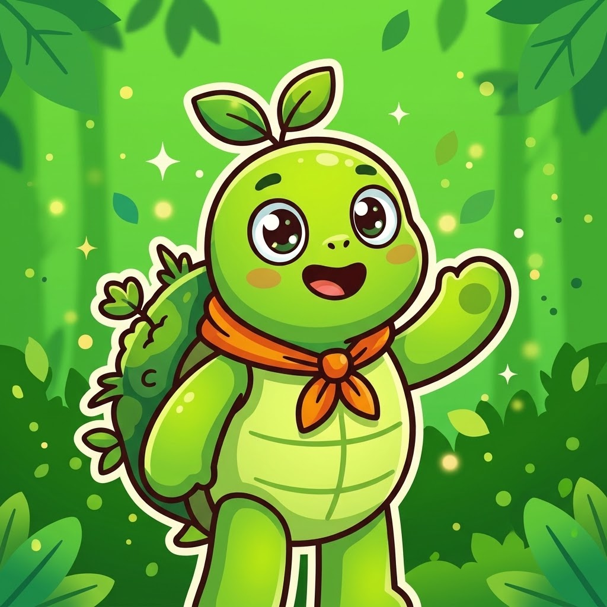
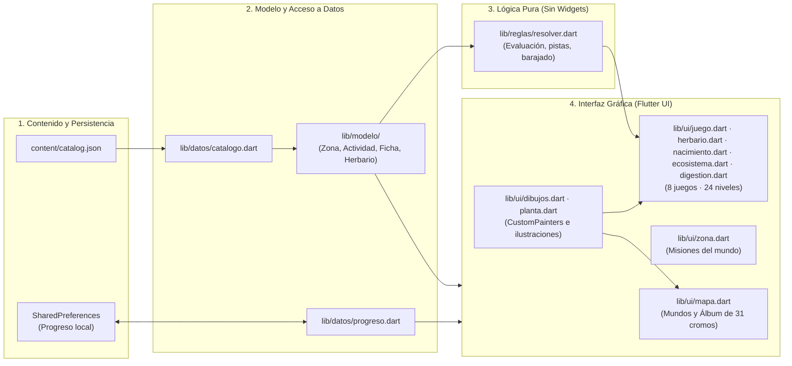
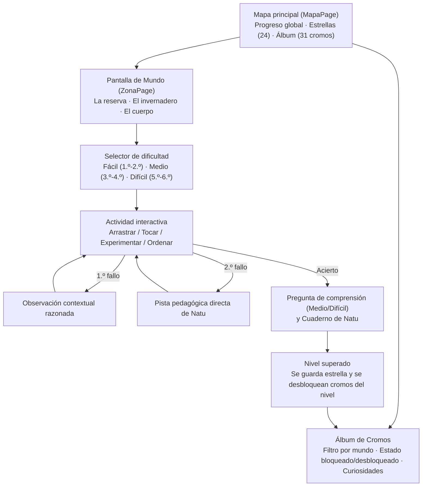

<div align="center">



# NaturalMente

**Ciencias de la Naturaleza interactivas para Educación Primaria (1.º a 6.º curso)**

[](https://flutter.dev)
[](https://dart.dev)
[](#comandos-de-desarrollo-y-compilación)
[](#arquitectura-del-proyecto)

</div>

---

## Descripción general

**NaturalMente** es una aplicación educativa de Ciencias de la Naturaleza para niños y niñas de Educación Primaria (**6 a 12 años**), desarrollada en **Flutter** con una única base de código para **Android** e **iOS** (y soporte en navegador para desarrollo). Funciona **100 % en local**, sin servidores, sin cuentas de usuario, sin anuncios y sin recogida de datos personales.

Guiados por **Natu**, los alumnos exploran **3 mundos**, superan **8 juegos interactivos** con **3 niveles de dificultad adaptados por ciclo** (`Fácil · 1.º-2.º`, `Medio · 3.º-4.º` y `Difícil · 5.º-6.º`, sumando **24 misiones**) y coleccionan **31 cromos** con curiosidades científicas en su álbum personal.

### Principios de diseño pedagógico y técnico

- **Aprendizaje sin frustración**: cuando el alumno se equivoca, la app nunca utiliza palabras punitivas (*«error»*, *«incorrecto»*, *«has fallado»*, *«mal hecho»*). En el primer intento fallido ofrece una observación razonada sobre lo elegido; en el segundo intento aporta una pista directa para guiar hacia la respuesta.
- **Progresión real por ciclo escolar**:
  - **Fácil (1.º-2.º)**: identificación visual directa, vocabulario cercano y mecánicas accesibles.
  - **Medio (3.º-4.º)**: ampliación de elementos y preguntas de comprensión tras resolver cada reto.
  - **Difícil (5.º-6.º)**: vocabulario científico de tercer ciclo (vertebrados e invertebrados, fotosíntesis, aparatos y sistemas, cigoto y multiplicación celular) y retos de razonamiento.
- **Catálogo desacoplado de la interfaz**: todo el contenido didáctico, pistas, curiosidades y preguntas reside en [`content/catalog.json`](content/catalog.json), separado de las reglas de evaluación (`lib/reglas/`) y de los componentes visuales (`lib/ui/`).
- **Ilustración vectorial e interactividad propia**: escenarios, laboratorio de germinación, modelo anatómico con colocación por arrastre o toque (*drag & drop* + *tap*) y visor de etapas de la vida renderizados mediante `CustomPainter` en Flutter.

---

## Mundos, actividades y niveles

| Mundo | Actividad | Mecánica principal | Fácil (1.º-2.º) | Medio (3.º-4.º) | Difícil (5.º-6.º) | Cromos (31) |
| :--- | :--- | :--- | :--- | :--- | :--- | :---: |
| **La reserva**<br>*(Animales)* | **Cada uno a su hogar** (`hogar`) | Clasificación de animales en su hábitat y adaptaciones al medio | 4 hábitats y 4 animales (*camello, delfín, pingüino, oso*) | 6 hábitats (+ *selva, río*) y 6 animales (+ *rana, tucán*) con pregunta de adaptación | 6 ecosistemas y 7 animales (+ *pulpo*, invertebrado marino) con preguntas de clasificación científica | 7 |
| **La reserva**<br>*(Animales)* | **¿Huevo o barriga?** (`nacimiento`) | Separar animales por cómo nacen y ordenar ciclos de vida, por arrastre o toque | 6 animales al *huevo* o a la *barriga de su madre* (*pingüino, tucán, rana · camello, delfín, oso*) | Ciclos de la *rana* y la *mariposa* en 4 pasos + pregunta de comprensión por ciclo | Metamorfosis de la *rana* en 5 fases y de la *mariposa* (larva, pupa, adulto) + preguntas de razonamiento (anfibio, en qué se parecen) | 3 |
| **La reserva**<br>*(Ecosistemas)* | **Monta el ecosistema** (`ecosistemas`) | Dar vida a un claro del bosque y descubrir conexiones | Hierba, conejo y zorro por arrastre o toque | Dos relaciones alimentarias con flechas explicadas | Dos predicciones y comparación antes/después | 1 |
| **El invernadero**<br>*(Plantas)* | **Haz crecer la semilla** (`germinacion`) | Simulación experimental día a día (Días 1, 3, 5 y 7) en bote transparente | 3 variables (*sustrato, agua, luz*) hasta lograr el brote en tierra o algodón | Experimento de 4 etapas + pregunta final sobre el papel de las sales minerales del suelo | 4 variables (+ *temperatura en °C*) + pregunta científica sobre fotosíntesis y germinación | 3 |
| **El invernadero**<br>*(Plantas)* | **Herbario desmontable** (`herbario`) | Montaje interactivo de las partes de la planta por arrastre o toque | 3 partes (*raíz, tallo, hoja*) sobre el modelo botánico | 5 partes (+ *flor, fruto*) con sus funciones y curiosidades | 5 partes + cuestionario sobre la función de cada órgano vegetal | 5 |
| **El cuerpo**<br>*(Cuerpo humano)* | **Cada pieza en su sitio** (`piezas`) | Atlas anatómico interactivo: arrastrar o tocar órganos hacia su cavidad | 3 órganos en 3 zonas: *cerebro* (Cabeza), *corazón* (Pecho) y *estómago* (Abdomen) | 5 piezas en 4 zonas (+ *pulmones* en Pecho y *músculos y huesos* en Extremidades) + reto de función | 6 piezas (+ *intestinos* en Abdomen) + preguntas sobre aparatos y sistemas del cuerpo humano | 6 |
| **El cuerpo**<br>*(Cuerpo humano)* | **El viaje de la comida** (`digestion`) | Llevar un bocado por el aparato digestivo tocando el cuerpo, los botones o arrastrándolo | *Boca* y *barriga*, con tres mordiscos para masticar y el pulmón como despiste | 4 paradas (*boca, esófago, estómago, intestino*) con pulmones y corazón como despistes + pregunta final | 5 partes (+ *intestino delgado y grueso*) + qué pasa en cada parada (*bolo, quimo, absorción, heces*) | 3 |
| **El cuerpo**<br>*(Cuerpo humano)* | **Así empieza una vida** (`vida`) | Línea temporal interactiva con visor de subetapas y explicación biológica | 4 viñetas: *unión de dos células, crecimiento en el útero, nacimiento y cuidados* | 5 fases (*fecundación, embrión con latido, feto con cordón, nacimiento y bebé*) + pregunta vivíparos | 6 fases (*cigoto, multiplicación celular, tejidos y órganos, placenta, parto y crecimiento por etapas*) | 3 |

---

## Arquitectura del proyecto

El proyecto separa estrictamente los **datos curriculares**, el **modelo de dominio**, las **reglas de negocio puras** (testeables sin necesidad de montar widgets) y la **capa de presentación**.



### Flujo de navegación y aprendizaje



---

## Estructura de carpetas y responsabilidades

| Ruta | Propósito | Responsable |
| :--- | :--- | :--- |
| [`lib/ui/`](lib/ui/) | Pantallas, navegación, animaciones e ilustraciones vectoriales (`CustomPainter`) | David |
| [`lib/reglas/`](lib/reglas/) | Evaluación de respuestas, progresión de pistas y barajado sin repetir posición (sin widgets) | Iván |
| [`lib/datos/`](lib/datos/) y [`lib/modelo/`](lib/modelo/) | Carga de `catalog.json`, modelos inmutables y persistencia local de estrellas y cromos | Alfredo / Equipo |
| [`content/`](content/) | Catálogo de juegos, textos pedagógicos (`catalog.json`) y mapa de cobertura (`cobertura.md`) | Alfredo |
| [`lib/ui/dibujos.dart`](lib/ui/dibujos.dart) y [`assets/icono/`](assets/icono/) | Ilustraciones vectoriales de personajes (`Natu`, animales) e icono de la aplicación | David |
| [`test/`](test/) | Pruebas unitarias de catálogo/reglas (`test/datos/`) y pruebas de integración de UI (`test/ui/`) | Diego |
| [`android/`](android/) e [`ios/`](ios/) | Configuración nativa, identificador (`com.naturalmente.naturalmente`), iconos y firmas | Alejandro |
| [`web/`](web/) | Soporte de ejecución local en Chrome durante el desarrollo | Equipo |
| [`docs/`](docs/) | Documentación de contexto, organización, decisiones de alcance y diseño de juegos | Todos |

### Documentación adicional en `docs/`

- **[`docs/contexto.md`](docs/contexto.md)**: objetivos de la asignatura, adecuación curricular y criterios pedagógicos.
- **[`docs/organizacion.md`](docs/organizacion.md)**: reparto detallado de tareas, estructura del proyecto e hitos del calendario.
- **[`docs/decisiones.md`](docs/decisiones.md)**: registro de decisiones de alcance, niveles de dificultad y qué contenidos quedan fuera.
- **[`docs/juegos.md`](docs/juegos.md)**: diseño detallado de las mecánicas de cada actividad por mundo y ciclo.
- **[`docs/plan-herbario.md`](docs/plan-herbario.md)**: especificación técnica y validación de la actividad *Herbario desmontable*.

---

## Requisitos previos e instalación

No es necesario configurar ninguna base de datos ni servidor externo. Basta con disponer de **Flutter** y, según dónde se quiera ejecutar, **Google Chrome** o el **SDK de Android**.

1. **Git** instalado en el sistema.
2. **Flutter SDK** (canal `stable`, con Dart `^3.13.5`). Guía oficial: [docs.flutter.dev/install](https://docs.flutter.dev/install).
3. Añadir la carpeta `bin` de Flutter al `PATH` del usuario. En PowerShell para la sesión actual:

   ```powershell
   $env:Path = "C:\Users\TU_USUARIO\flutter\bin;" + $env:Path
   ```

4. **Google Chrome** (para depuración rápida en web) o **Android Studio / Android SDK** (para emulador Android o generación de APK/AAB). En macOS, **Xcode** para compilar en iOS.

Verifica el entorno ejecutando:

```powershell
flutter doctor
```

Si es la primera vez que usas el SDK de Android en el equipo, acepta las licencias:

```powershell
flutter doctor --android-licenses
```

---

## Comandos de desarrollo y compilación

Desde la raíz del repositorio:

### 1. Instalar dependencias, analizar código y ejecutar tests

```powershell
flutter pub get
dart analyze
flutter test
```

- `flutter pub get`: descarga las dependencias declaradas en [`pubspec.yaml`](pubspec.yaml).
- `dart analyze` / `flutter analyze`: comprueba el tipado estático y las reglas de estilo (`flutter_lints`).
- `flutter test`: ejecuta la batería de pruebas unitarias (catálogo, reglas de los 8 juegos, barajador sin repetición, desbloqueo de los 31 cromos) y pruebas de widgets/flujos completos en pantalla.

### 2. Ejecutar la aplicación en local

Para lanzarla rápidamente en **Chrome** durante el desarrollo:

```powershell
flutter run -d chrome
```

*(Con la app en marcha: pulsa `r` para recarga rápida, `R` para reinicio completo y `q` para salir).*

Para lanzarla en un **emulador de Android** o dispositivo conectado por USB:

```powershell
flutter emulators
flutter emulators --launch <id_emulador>
flutter devices
flutter run -d android
```

### 3. Generar paquetes de distribución (Release)

- **APK de Android** (para instalar directamente en un dispositivo o compartir el archivo):

  ```powershell
  flutter build apk
  ```
  *(Salida generada en `build/app/outputs/flutter-apk/app-release.apk`).*

- **Android App Bundle** (formato oficial para publicar en Google Play):

  ```powershell
  flutter build appbundle
  ```

- **Archivo IPA para iOS** (requiere macOS con Xcode):

  ```powershell
  flutter build ipa
  ```

---

<div align="center">
  <sub>Identificador de paquete: <code>com.naturalmente.naturalmente</code> · Nombre de la aplicación: <strong>NaturalMente</strong></sub>
</div>

### Idioma de la app

El botón ES/EN permite elegir **Español** o **English** solo en el mapa principal, debajo de la cabecera de NaturalMente y antes de «Mundos para explorar». Traduce también las fichas, las pistas, los juegos y el álbum. La elección se conserva al cerrar y volver a abrir, y se aplica a toda la app sin borrar el progreso. Español es el idioma inicial.

### Monta el ecosistema

Nueva misión de La reserva con ilustración vectorial propia, tres niveles y un cromo del bosque. Su [plan y validación](docs/plan-ecosistemas.md) describen el recorrido, las comprobaciones y los pendientes en dispositivos. Funciona en ambos idiomas y conserva los requisitos de la medalla.

### Cierre de los juegos

Este comportamiento es obligatorio para todos los juegos y niveles, incluidos los nuevos. Los agentes deben consultar [AGENTS.md](AGENTS.md) y la [guía de implementación de feedback y cierre](docs/feedback-y-cierre.md).

Al superar un nivel, la animación del check verde, el sonido y la vibración dan paso automáticamente a una pantalla de resultado. Muestra el resumen y mantiene visibles las opciones **Cambiar nivel**, **Otra vez** y **Volver al mundo**. El botón de cerrar permite seguir explorando las explicaciones y curiosidades del ejercicio.

Las acciones esperan al guardado; si falla, se ofrece **Guardar de nuevo** sin repetir respuestas ni recompensas. El reto diario conserva su límite de una misión por día y ofrece **Volver al mapa** y **Armario de Natu**. Las pruebas recorren los tres niveles de los 16 juegos y del reto diario, además del guardado, la repetición y la accesibilidad del cierre.
