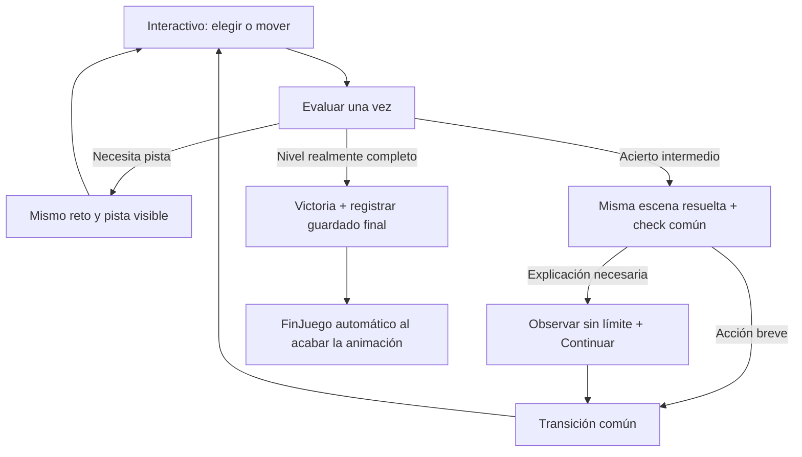

# Plan de feedback, atención y transiciones de los juegos

Fecha: 15 de noviembre de 2026. Estado: implementación incremental en `david/feedback-y-transiciones`.

## Primer incremento

Implementado el coordinador común en FeedbackAcierto: adquisición síncrona del paso, confirmación ligada al final real del check, transición de 160 ms, observación opcional con Continuar y cancelación al reiniciar o destruir la pantalla. Los relojes del check y la transición se pausan en segundo plano; el modo reducido mantiene la confirmación y omite la transición decorativa.

El piloto está aplicado a las 17 actividades de tipo `lugar` que usan JuegoPage, en sus tres dificultades. Conserva el reto acertado durante el check, retrasa las preguntas de comprensión y el progreso presentado y descarta respuestas repetidas. Los tableros del cuerpo, sentidos y montaje del plato conservan la escena sin desvanecerla. Durante estos ejercicios la insignia de precisión es compacta, sin efectos ni escucha directa del combo global; su número se presenta después de confirmar.

La API disponible y su contrato están documentados en [la guía común](feedback-y-cierre.md). Hay pruebas temporales de conservación del reto, comprensión, doble toque, Continuar, cancelación, movimiento reducido y segundo plano, además del recorrido de cierre existente de todos los juegos.

Validación de este incremento: `dart analyze --fatal-infos` sin incidencias y `flutter test` con 263 pruebas correctas, incluidas las suites compartidas de feedback, resultado y cierres. No se ha realizado todavía la validación manual en teléfono ni con niños.

Los pendientes de código de este primer incremento se completan en el segundo, descrito a continuación. La validación física y con niños sigue pendiente.

## Segundo incremento · 16 de noviembre de 2026

Extendido el flujo a germinación, orden, herbario, nacimiento, digestión, ecosistemas, rescate, memoria, adivinanzas y reto diario. Los 26 juegos y las tres dificultades mantienen el cierre común y sus preguntas obligatorias. La primera carta de memoria, el orden provisional y los controles no celebran aciertos; los mordiscos de digestión se distinguen de una respuesta evaluada cuyo identificador también pueda ser `masticar`.

Las reglas de adivinanzas y rescate separan resolver de `siguiente()`. Los ciclos de nacimiento y los ecosistemas también avanzan tras confirmar; las preguntas de herbario y digestión conservan su identificador presentado mientras se confirma la respuesta. Las explicaciones que necesitan lectura esperan a Continuar, y el resultado final conserva su explicación consultable sin añadir un paso obligatorio al cierre.

Unificados los indicadores discretos, selección de 120 ms, asentamiento local de 160 ms y progreso interpolado de 160 ms, respetando el movimiento reducido. Los anuncios del contenido se suspenden durante el check y la transición; se evita que los contadores compitan con la explicación. La revisión de controladores confirma que los bucles ambientales restantes están en el mapa y los laboratorios libres, fuera del alcance acordado; no se introducen bucles en los juegos.

La precisión se aplica una sola vez a la partida y se guarda por separado. Las escrituras intermedias se serializan y pueden reintentarse desde un aviso común; el cierre espera a que se recuperen las pendientes. Salir cancela la presentación, pero permite terminar el guardado ya aceptado con sus datos originales. Las compras se serializan con los cambios de saldo.

El reto diario calcula su bono antes de registrar la victoria. Un registro de cierre pendiente conserva el destino de la recompensa antes de escribir el saldo. Se puede recuperar tras un fallo parcial o reinicio para guardar el resultado sin repetir preguntas ni bono. Esto no añade recuperación de partidas incompletas al cerrar el proceso.

Las pruebas incluyen recorridos completos, conservación temporal de preguntas, selección sin evaluar, doble toque, explicaciones con Continuar, movimiento reducido, escrituras lentas/fallidas, reintentos, recuperación del cierre diario y salida durante una victoria cuyo guardado continúa pendiente.

Validación del 16 de noviembre: `dart analyze --fatal-infos` sin incidencias, las tres suites compartidas correctas y `flutter test` con **293 pruebas correctas**. También se han comprobado los enlaces de la documentación y las traducciones añadidas.

**Pendiente de validación humana:** sensación y tiempos en teléfono Android/iOS, sonido y vibración físicos, recorrido con lector de pantalla y sesiones supervisadas con niños. Ajustar las duraciones centralizadas si esas sesiones lo aconsejan. El código no sustituye esas comprobaciones.

## Objetivo y alcance

Que el niño entienda qué acaba de acertar y cuál es su siguiente acción, sin que el check, la nueva pregunta, la racha y el movimiento del escenario compitan entre sí.

Se aplica a los 26 juegos del catálogo, sus tres dificultades y el reto diario. Compartimos la secuencia y los criterios de atención; cada mecánica conserva su forma de jugar. También se revisan las animaciones ambientales que estén visibles dentro de esos ejercicios. El mapa y los laboratorios libres quedan para una tarea posterior, salvo los componentes reutilizados por los juegos.

Este plan desarrolla el apartado 5 de la revisión de usabilidad. No incluye rediseñar menús, añadir lectura por voz, cambiar puntuaciones, reducir contenido curricular ni rediseñar la pantalla de resultados. Respeta [las decisiones de producto](decisiones.md), [la guía obligatoria de feedback y cierre](feedback-y-cierre.md) y [las instrucciones del repositorio](../AGENTS.md).

## Punto de partida antes de la migración

La tabla conserva el diagnóstico que motivó el plan; sus problemas de coordinación ya se han abordado en los incrementos anteriores. No representa una prueba con niños ni una nueva inspección visual del dispositivo.

| Superficie | Comportamiento comprobado | Cambio necesario |
| --- | --- | --- |
| [Feedback compartido](../lib/ui/feedback_acierto.dart) | El check normal dura 1250 ms y la victoria 2350 ms. El overlay normal ignora los toques; solo la victoria con cierre introduce una barrera. | Añadir coordinación del paso y protección de entradas, además del efecto visual existente. |
| [Clasificación y preguntas](../lib/ui/juego.dart) | `_soltar` y `_responderAdaptacion` pueden cambiar `_reto`, limpiar el resultado y barajar antes de `mostrarAcierto()`. | Conservar el reto acertado durante la confirmación y posponer el avance visible. |
| [Nacimiento](../lib/ui/nacimiento.dart) y [ecosistemas](../lib/ui/ecosistema.dart) | Hay llamadas a `siguiente()` o `seguir()` en el mismo cambio de estado que evalúa la respuesta. | Separar evaluación y avance; retrasar las preguntas y el desplazamiento hasta terminar el feedback. |
| [Herbario](../lib/ui/herbario.dart) y [digestión](../lib/ui/digestion.dart) | La respuesta cambia la partida y puede iniciar `ensureVisible` inmediatamente. | Mantener la pieza o parada confirmada y desplazar a la pregunta posterior en un segundo momento. |
| [Adivinanzas](../lib/reglas/adivinanza.dart) | `adivinar` incrementa la ronda al acertar; la vista usa el armazón [JuegoPropio](../lib/ui/juego_propio.dart). | Separar la resolución de la ronda de la apertura de la siguiente. |
| [Memoria](../lib/reglas/memoria.dart) y [rescate](../lib/ui/rescate.dart) | El resultado puede permanecer sobre un tablero acumulativo; no requieren siempre cambiar de pantalla o ronda. | Confirmar sobre el tablero, sin introducir un botón de continuar en cada pieza. |
| [Reto diario](../lib/ui/expedicion_diaria.dart) | `_elegirOpcion` tiene esperas de persistencia y llama a `_siguientePaso` inmediatamente después de iniciar el check. | Bloquear la evaluación antes del primer `await`, conservar respuesta y explicación, separar avance y guardado. |
| [Insignia de precisión](../lib/ui/componentes_juego.dart) | Lee el combo global y lanza pulso, giro y partículas durante 620 ms al cambiar. | Reservar su espacio, quitar las explosiones durante el juego y controlar cuándo se actualiza visualmente. |

No basta con retrasar un `setState`: algunas reglas ya avanzan internamente y varios componentes escuchan directamente el progreso global.

## Política de interacción

1. **Seleccionar:** marca la pieza y los destinos posibles. No muestra check, suma recompensas ni produce sonido de acierto. Una colocación evaluada sí puede ser un acierto.
2. **Evaluar:** aceptar una única respuesta para el paso actual. Desde este momento se impiden más respuestas, selecciones y arrastres de ese tablero hasta completar la transición.
3. **Confirmar:** mantener el enunciado, la elección y la escena resuelta; mostrar el check común. La siguiente pregunta todavía no existe en la presentación ni en el foco accesible.
4. **Observar:** si hay una explicación necesaria para comprender el resultado, dejarla sin límite de tiempo y ofrecer **Continuar**. El botón aparece al terminar el check; no puede saltar la confirmación. No añadirlo en cada pieza de un montaje ni en cada pareja de memoria.
5. **Avanzar:** retirar el efecto, actualizar el progreso visual una vez y presentar el siguiente reto, pregunta de comprensión o acción del mismo tablero. Solo entonces se rehabilita la interacción.
6. **Terminar:** si no quedan tareas evaluables, iniciar directamente la variante de victoria y registrar el guardado final. No encadenar check normal y victoria para una misma respuesta.

### Cuándo se avanza solo

| Situación | Después del check |
| --- | --- |
| Clasificación breve sin explicación imprescindible | Cambio automático al siguiente elemento, conservando brevemente la respuesta acertada durante el check. |
| Pregunta de comprensión pendiente | Mostrar esa pregunta; el nivel sigue abierto. No adelantar otro animal ni saltarla. |
| Explicación necesaria, comparación antes/después, revelación de una adivinanza o explicación del reto diario | Mantener el resultado y ofrecer Continuar. La explicación de la última respuesta también puede leerse desde el resumen, sin retrasar el cierre automático obligatorio. |
| Herbario, cuerpo, rescate o memoria en tablero acumulativo | Mantener las piezas o parejas acertadas; rehabilitar el tablero. Continuar solo al pasar a una fase con explicación necesaria. |
| Germinación | El gesto de riego o mover un control no se convierte en acierto. Celebrar únicamente la etapa evaluada; mantener visible su efecto antes de habilitar el siguiente día o pregunta final. |
| Última respuesta del nivel, incluidas las preguntas finales | Victoria y apertura automática de FinJuego; nunca exigir Continuar para poder terminar. |

La política depende del contenido y la mecánica, no solo de Fácil/Medio/Difícil. Un texto necesario no desaparece porque el usuario juegue en Difícil. Las curiosidades opcionales siguen disponibles mediante sus controles actuales y no crean una parada obligatoria.

### Intento que necesita una pista

Mantener el mismo reto, mostrar una observación concreta y señalar la elección con borde e icono, además del color. No check, sacudida, destellos rojos ni animación de pérdida de racha. Conservar las reglas actuales de pistas y puntuación. Una vez visible la pista, permitir volver a intentarlo; el anuncio accesible no debe impedir responder.

En memoria, las dos cartas que no forman pareja siguen visibles hasta que el niño toca otra, como hoy; no añadir un reloj para ocultarlas. En una adivinanza, una pista nueva se anuncia sin cambiar de ronda.

## Estados y flujo común

El coordinador de presentación define `FasePaso` con los estados `interactivo`, `evaluando`, `confirmando`, `observando`, `transicionando` y `victoria`. La cancelación invalida el callback mediante la versión de sesión y devuelve el control a `interactivo`; no conserva una pantalla de estado cancelado.

La pregunta intermedia o final se convierte en la siguiente acción de `interactivo`, no en una excepción que salta directamente a victoria. El progreso visual representa lo resuelto; se actualiza después del check intermedio sin adelantar la siguiente respuesta.

## Guion de animaciones

Los tiempos nuevos son valores iniciales para ajustar con una prueba de uso; no resultados validados. Se centralizan, nunca se copian en los juegos.

| Momento | Propuesta inicial | Qué permanece estable |
| --- | --- | --- |
| Seleccionar pieza/destino | Borde y fondo en 100–120 ms; sin rebote ni efecto de escala que cambie el área táctil. | Enunciado, opciones y cámara. |
| Colocación confirmada | Asentamiento local de 120–160 ms, simultáneo con el inicio del check, no como espera adicional. | Pieza en su destino; no aparece aún otra pregunta. |
| Check intermedio | Conservar inicialmente los 1250 ms y el check centrado actuales. No cambiar su tamaño ni su contrato en esta primera entrega. | Reto acertado, resultado y destinos. |
| Cambio de reto/fase | Desvanecimiento de 160 ms, sin deslizamiento lateral, reordenación animada ni zoom. | Cabecera, altura de los indicadores y contexto del mundo. |
| Tablero acumulativo | Sin desvanecer todo el tablero: retirar el check y devolver el control. | Piezas ya colocadas y cartas descubiertas. |
| Barra de progreso | Interpolación de 160 ms durante la transición; una actualización por paso evaluado. | Tamaño y posición de la barra. |
| Explicación necesaria | Aparición de 120 ms después del check; sin cuenta atrás. | Texto y Continuar permanecen hasta la acción del usuario. |
| Victoria | Conservar inicialmente los 2350 ms y el cierre común; fanfarria y patrón de vibración de final únicamente aquí. El acierto intermedio mantiene su sonido y vibración comunes. | Resultado final; ninguna nueva pregunta debajo. |

Para un acierto breve, el objetivo inicial es recuperar el control en aproximadamente 1,4 segundos desde la evaluación, sin sumar varias esperas decorativas. La persistencia lenta no alarga el check: tiene su estado propio en el cierre o su tratamiento recuperable en el paso intermedio. Antes de acortar los 1250 ms, comprobar comprensión y ritmo; no usar una preferencia de movimiento reducido para acelerar la lectura.

### Un foco visual cada vez

- Durante `interactivo`, el foco es el objeto y sus destinos. Natu permanece quieto mientras se lee; un gesto breve puede acompañar una pista nueva.
- Durante `confirmando`, el check es el único efecto dominante. Pausar los movimientos ambientales decorativos y las celebraciones de cabecera; conservar los cambios que explican el resultado, como la manzana llegando a un órgano o el brote apareciendo.
- Durante `observando`, escena estática. Una animación científica necesaria tiene pausa/reproducción accesibles; no necesita repetirse para poder contestar.
- Durante `transicionando`, un único cambio de contenido. No ejecutar a la vez scroll, rebote, partículas y nuevo enunciado.
- El scroll para mostrar una pregunta se ejecuta después del check y como parte de la transición; no añadir otro desvanecimiento simultáneo. Solo desplazar si el destino no está suficientemente visible.

### Racha y semillas

Mantener el cálculo y el guardado actuales. Cambiar su presentación durante el ejercicio: indicador compacto, estático y con espacio reservado; sin partículas, giros, ampliaciones, mensajes «En llamas» ni semillas volando. Evitar que un cambio de racha acorte el título.

Actualizar los números visibles al terminar la confirmación, aunque el dato ya esté registrado. Quitar la escucha directa del combo global en la insignia durante una partida y pasarle el estado presentado por el coordinador; no retrasar la persistencia para conseguir el efecto visual. En el cierre se puede presentar el total con una única aparición. No modificar la racha diaria ni el sistema económico en esta tarea.

## Accesibilidad, sonido y cancelaciones

- Movimiento reducido: selección y resultado mediante borde/icono; sin escala, giro, partículas, desplazamiento decorativo ni scroll animado. Mantener la confirmación legible y el mismo flujo. Reutilizar `MediaQuery.disableAnimationsOf(context)` y no introducir un ajuste distinto por juego.
- El check, el audio y la vibración siguen coordinados exclusivamente por FeedbackAcierto e Idioma, con sonido y vibración independientes. Mantener los sonidos funcionales de selección y pistas; no añadir fanfarrias intermedias.
- Un único anuncio accesible por resultado. Anunciar después la nueva pregunta; no anunciarla mientras aún se confirma la anterior. El indicador de semillas no produce otro anuncio simultáneo. El tablero debe quedar protegido también frente a teclado y lector de pantalla, no solo frente a toques.
- La pista, selección y respuesta correcta se distinguen por forma/icono/texto, además del color. Los textos nuevos se traducen en [content/en.json](../content/en.json); comprobar ES/EN, tamaños de letra y temas claro/oscuro con [el tema actual](../lib/ui/tema.dart).
- Volver, cambiar nivel o repetir invalidan el paso pendiente y llaman a `ocultarAcierto()` antes del reinicio. Una finalización tardía no puede cambiar el nivel siguiente ni abrir otro resultado.
- Al poner la app en segundo plano, pausar la presentación y los efectos. Al volver, retomar el mismo resultado sin volver a puntuar ni reproducir el sonido inicial; si se destruyó la ruta, cancelar. No añadir recuperación de partidas tras cerrar el proceso en esta tarea.
- Si se solicita volver durante un acierto intermedio, cancelar su transición y respetar la navegación existente. La victoria y el guardado final mantienen las protecciones de FinJuego. No convertir todo el acierto intermedio en una barrera modal global.

## Diseño técnico propuesto

### 1. Separar evaluación y avance

La evaluación produce un resultado estable del paso: identificador de partida/paso, elección, acierto, frase y destino posterior (otro elemento, pregunta, mismo tablero o fin). Puntuar una única vez al aceptar ese resultado. Calcular si termina el nivel antes de limpiar o incrementar índices; las preguntas pendientes impiden ese fin.

Preferir separar los métodos de evaluar y avanzar allí donde hoy se mezclan. En Adivinanza, por ejemplo, resolver la ronda y abrir la siguiente deben ser operaciones distintas; actualizar también sus pruebas de reglas. Evitar congelar visualmente un árbol que sigue leyendo una partida ya mutada. Un snapshot puntual solo sirve para datos inmutables de la respuesta, no como duplicado completo del estado del juego.

### 2. Ampliar el mecanismo compartido

FeedbackAcierto mantiene `mostrarAcierto()`, `mostrarAcierto(finalDeNivel: true)`, `ocultarAcierto()`, `registrarGuardadoFinal(...)` y `construirFinJuego()`. Los incrementos añaden `iniciarPasoEvaluado()`, `confirmarPaso(alContinuar: ..., esperarContinuar: ...)`, `terminarIntentoConPista()` y `construirContenidoPaso(widget)`. El callback de continuación se ejecuta tras la retirada real del check o al pulsar Continuar; cancelar lo descarta. Todas las pantallas de juego adoptan este conjunto de operaciones.

La API actual `mostrarAcierto()` devuelve `void`: no se puede simplemente hacer `await mostrarAcierto()`. El avance debe depender de la finalización real del AnimationController mediante el mecanismo común, nunca de Timer/Future.delayed por juego.

Un token de sesión/paso invalida callbacks tras navegar, reiniciar o cambiar nivel. Adquirir el bloqueo de evaluación sincrónicamente antes de cualquier `await`. No encolar respuestas rápidas para aplicarlas sobre el próximo reto. Cancelar una animación no equivale a completarla ni ejecuta su avance.

La migración puede conservar temporalmente las llamadas antiguas para que cada entrega compile. El objetivo final es que todos los pasos evaluados pasen por la coordinación común; no mantener dos secuencias permanentes de éxito.

### 3. Aislar persistencia y presentación

El callback de avance solo cambia la presentación/fase; no evalúa, suma puntos ni guarda otra vez la jugada. La identidad del paso protege frente a doble toque y resultados tardíos. Si ya existe una operación de persistencia en curso, se conserva su resultado: no se sustituye por un éxito ficticio.

En final de nivel, llamar a `mostrarAcierto(finalDeNivel: true)` y registrar inmediatamente el guardado final, antes de cualquier espera. El callback de guardado solo persiste y devuelve el estado real. En el reto diario, separar `_siguientePaso` de la persistencia final para que un reintento de guardado no avance fases ni recalcule bonos.

Auditar `registrarAciertoPrecision` y `completarExpedicionDiaria` en [Progreso](../lib/datos/progreso.dart): no añadir una nueva entrega de recompensa en los callbacks de animación. Para un fallo de guardado intermedio, conservar el resultado ya evaluado y reintentar solo su persistencia, con una indicación recuperable común; no reenviar la respuesta. Mantener cada operación asociada al paso original y serializar escrituras que comparten progreso.

## Adaptación por mecánica

| Familia | Adaptación concreta |
| --- | --- |
| Clasificación de animales, plantas, sentidos, alimentos, hábitos y órganos | Resolver elemento actual, mantenerlo durante el check, abrir comprensión si corresponde y avanzar después. Barajar al preparar el nuevo reto, sin movimiento de las opciones bajo el dedo. |
| Cuerpo y herbario | La pieza correcta queda colocada. Abrir funciones/pregunta después del check; mover el scroll una vez. |
| Nacimiento | Fácil mantiene animales colocados; Medio/Difícil conserva el ciclo resuelto y su comprensión antes de llamar a siguiente. |
| Germinación y orden de la vida | Diferenciar preparación de controles/orden provisional y comprobación evaluada. Los resultados visuales se conservan antes de pasar de fase; la pregunta final bloquea la victoria. |
| Ecosistemas | Mantener lo colocado y el antes/después; no ejecutar seguir dentro de la evaluación. Las explicaciones causales usan Continuar. |
| Digestión | Mantener la parada alcanzada. Masticar sigue siendo acción de proceso, sin sumar un acierto por cada mordisco. La nueva pregunta aparece después de confirmar la parada evaluada. |
| Memoria | La primera carta solo se descubre; la segunda evalúa. Pareja correcta permanece visible y el tablero se rehabilita tras el check. Pareja no coincidente conserva el comportamiento de observación sin reloj. |
| Adivinanzas | Mostrar el animal revelado y su explicación; Continuar abre la siguiente ronda. La última ronda conduce directamente a victoria y su explicación queda consultable en el cierre. |
| Rescate | Conservar la escena y lo recogido/clasificado; aplicar pausa de observación solo cuando cambia una fase con explicación necesaria. |
| Reto diario | Fijar la respuesta correcta y explicación hasta Continuar, salvo la última que abre el cierre automáticamente. Bloqueo previo al primer await y límite diario intacto. |

## Entregas y orden de implementación

| Entrega | Cambios | Condición para seguir |
| --- | --- | --- |
| 1. Contrato y coordinador | Estados, cancelación, bloqueo, finalización observable y pruebas del componente; precisar los contratos de evaluación/avance. Actualizar la guía común con la API que finalmente exista. | Pruebas de orden, doble toque, cancelación y cierre pasan sin duplicar audio ni recompensas. |
| 2. Piloto en JuegoPage | Clasificación Fácil y con comprensión, controles de germinación y orden; después recorrer todas las actividades atendidas por esa pantalla. | El reto antiguo permanece bajo el check; preguntas pendientes y final de nivel correctos. |
| 3. Pantallas propias | Herbario, nacimiento, digestión, ecosistemas y rescate; luego JuegoPropio, memoria y adivinanzas, incluidas sus reglas. | Cada familia funciona en los tres niveles y al repetir/cambiar/volver. |
| 4. Reto diario | Separar resultado, avance y persistencia; conservar su cierre y restricciones. | Doble toque durante await, premio diario y reintento sin duplicados comprobados. |
| 5. Jerarquía visual y movimiento | Insignia compacta, números presentados, progreso y pausas de movimiento ambiental; aplicar desde el piloto el modo reducido a cualquier animación nueva. | Un foco dominante, ninguna animación infinita impide completar pruebas y la cabecera no salta. |
| 6. Recorrido y ajuste | Verificación global, grabación o revisión manual en teléfono y pequeñas sesiones con niños de dos ciclos de edad. Ajustar duraciones centralizadas según observación. | Criterios de aceptación cumplidos; registrar cualquier verificación humana pendiente sin darla por realizada. |

Cada entrega debe quedar utilizable y probada. No hacer un cambio masivo de todos los juegos antes de comprobar el piloto. No estimar días cerrados antes de resolver la separación de reglas y presentación en ese piloto.

## Pruebas y criterios de aceptación

Adaptar [feedback_acierto_test.dart](../test/ui/feedback_acierto_test.dart), [fin_juego_test.dart](../test/ui/fin_juego_test.dart), [cierres_juegos_test.dart](../test/ui/cierres_juegos_test.dart) y las pruebas de cada mecánica. El recorrido compartido debe contemplar Continuar donde corresponda, sin pulsarlo indiscriminadamente para ocultar un flujo incorrecto.

Pruebas temporales con `pump` en puntos concretos: al aceptar, durante el check, al retirarlo y al abrir la siguiente acción. `pumpAndSettle` por sí solo no detecta el problema de mostrar la pregunta nueva demasiado pronto.

- [ ] Seleccionar, arrastrar provisionalmente y descubrir la primera carta no producen acierto ni recompensa.
- [ ] Durante el check normal se ve el mismo reto y su elección correcta; no se anuncia la siguiente pregunta.
- [ ] Dos toques, dos arrastres o un toque de teclado durante evaluación/animación producen una sola jugada; también durante las esperas del reto diario.
- [ ] Una explicación necesaria permanece hasta Continuar; ese botón no salta preguntas ni entrega puntos.
- [ ] En tableros acumulativos se conserva lo colocado y no aparece Continuar por cada pieza.
- [ ] El último paso inicia una sola victoria; comprensión y preguntas finales pendientes la impiden.
- [ ] Sonido y vibración se disparan una vez y respetan sus ajustes independientes; movimiento reducido conserva significado sin desplazamientos decorativos.
- [ ] Cambiar nivel, repetir, volver, segundo plano y destruir la ruta no dejan callbacks, overlays, scrolls o cierres tardíos.
- [ ] Guardado lento o fallido no duplica semillas, estrellas, cromos ni bonos diarios; reintentar no ejecuta la respuesta ni el avance.
- [ ] Cabecera estable, texto ampliado, ES/EN, temas claro/oscuro, móvil pequeño y horizontal sin controles esenciales ocultos.
- [ ] Las 26 actividades y el reto diario usan el contrato común, con recorridos en sus tres niveles.

En cada incremento se ejecutan las comprobaciones de [la guía](feedback-y-cierre.md): `dart analyze --fatal-infos`, las tres suites compartidas y `flutter test`. Compilar Android si se modifica código nativo. Comprobar también referencias y correspondencia de esta documentación con las APIs implementadas.

La validación con niños debe observar si pueden señalar qué acaban de acertar, encontrar la siguiente acción sin ayuda y leer una explicación sin que desaparezca. Comparar con el comportamiento anterior mediante sesiones supervisadas, sin añadir analítica ni recogida de datos a la app.
